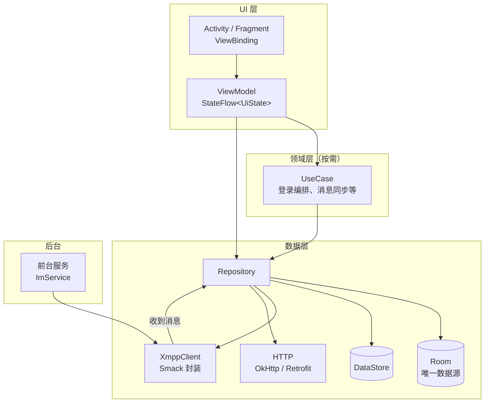
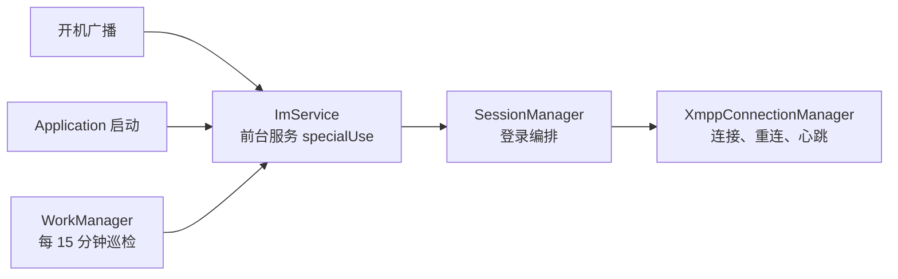
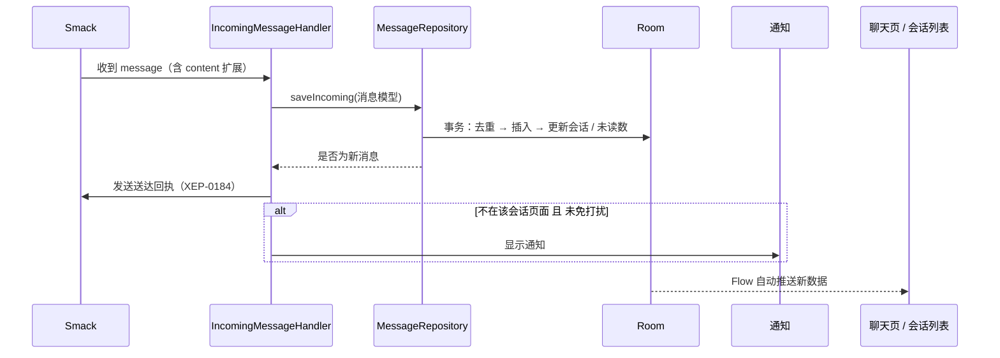
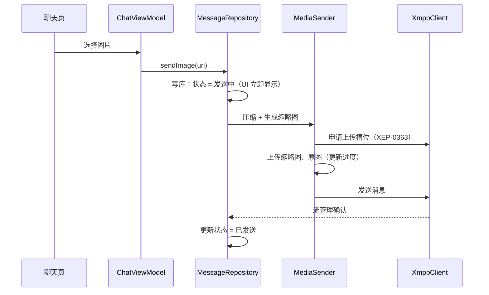

# Android 工程架构设计

> 版本：v0.1（草案）　日期：2026-10-13
>
> 依据：《IM功能清单.md》（功能范围）、《三端协议规范.md》（通信协议）。
> 本文档定义 Android 客户端的技术选型、分层结构、包结构、数据库设计、关键流程和测试策略。

## 目录

- [1. 技术选型](#1-技术选型)
- [2. 整体架构](#2-整体架构)
- [3. 工程与包结构](#3-工程与包结构)
- [4. 核心组件](#4-核心组件)
- [5. 数据库设计](#5-数据库设计)
- [6. 关键流程](#6-关键流程)
- [7. UI 层约定](#7-ui-层约定)
- [8. 日志](#8-日志)
- [9. 测试策略](#9-测试策略)
- [10. 编码规范](#10-编码规范)
- [11. 已确认事项](#11-已确认事项)

---

## 1. 技术选型

### 1.1 已确定

| 类别 | 选型 | 说明 |
| --- | --- | --- |
| 语言 | Kotlin | AGP 9 内置 Kotlin 支持，无需单独应用 `kotlin-android` 插件 |
| 异步 | Kotlin 协程 | 所有耗时操作使用 `suspend` 函数；Smack 回调统一包装为协程 / Flow |
| 数据流 | Kotlin Flow | 数据库查询返回 `Flow`，UI 状态用 `StateFlow`，一次性事件用 `Channel` |
| 架构组件 | ViewModel | 每个页面一个 ViewModel，持有 `StateFlow<UiState>` |
| 视图绑定 | ViewBinding | 禁止 `findViewById`、禁止 Kotlin synthetics |
| UI | View 体系 | XML 布局 + RecyclerView（`ListAdapter` + `DiffUtil`） |
| 数据库 | Room + 协程 | DAO 使用 `suspend` / `Flow`；注解处理器走 KSP |
| 网络请求 | OkHttp + Retrofit + 协程 | 官网版本 API、文件上传下载；全局共享一个 `OkHttpClient` |
| 图片加载 | Coil 3 + `coil-network-okhttp` | 复用全局 `OkHttpClient`，自动继承 TLS 证书配置 |
| 配置持久化 | DataStore（Preferences） | 用户设置、登录凭证（加密后存储）、同步游标以外的轻量配置 |
| JSON | kotlinx.serialization | Retrofit 使用 `kotlinx-serialization-converter`；数据类加 `@Serializable` |
| 单元测试 | 见 §9 | 能写测试的类和方法都要写；使用 `testing-setup` skill 搭建测试体系 |

### 1.2 由功能需求决定的选型

| 类别 | 选型 | 理由 |
| --- | --- | --- |
| XMPP | Smack 最新正式版（当前 4.5.x，用户确认直接使用最新版）（`smack-android`、`smack-tcp`、`smack-im`、`smack-extensions`、`smack-experimental`） | Android 上最成熟的 XMPP 库；支持流管理、Carbons、MAM、MUC、HTTP File Upload |
| 音视频 | WebRTC Android 预编译库（如 `io.getstream:stream-webrtc-android`） | 三端统一 WebRTC（协议规范 §12）；需验证 H.264 硬件编解码 |
| 后台任务 | WorkManager | 保活巡检（定期检查前台服务是否存活）、日志上传重试 |
| 应用启动初始化 | AndroidX Startup | 沿用现有日志库的初始化方式（见 §8） |
| 分页 | Paging 3（`paging-runtime` + `room-paging`） | 聊天记录分页加载（已确认，见 §11） |
| 日志 | 自有 `cn.android666:logback-android` | 沿用 `日志库/` 中的方案，按工号区分日志文件 |
| 拼音 | 轻量拼音库（如 TinyPinyin） | 本地搜索、通讯录字母索引；组织架构数据中服务器已提供拼音，本地只用于群名、备注等 |

> **依赖版本规则**：
> - 统一在 `gradle/libs.versions.toml` 管理。
> - 一律使用**最新的正式发布版（release）**；**禁止**使用 alpha、beta、rc、dev、SNAPSHOT、M（里程碑）等预发布版本。
> - 添加或升级依赖前，先查询 Maven Central / Google Maven 确认当时的最新正式版，不凭记忆填写版本号。
> - 必须确认支持 minSdk 24，且与 AGP、Kotlin 版本兼容；最新正式版不兼容时，退回到兼容的最高正式版，并在 `libs.versions.toml` 中用注释写明原因。

### 1.3 不使用

| 不使用 | 原因 |
| --- | --- |
| Jetpack Compose | 约束：使用 View 体系 |
| Gson / Moshi | 约束：统一使用 kotlinx.serialization |
| Glide | 约束：使用 Coil |
| SharedPreferences | 约束：使用 DataStore（日志库初始化读取工号时例外，见 §8） |
| Google Play 服务、Firebase、厂商推送 SDK | 专网 + 定制机，不可用 |
| RxJava、LiveData | 统一使用协程 + Flow |

---

## 2. 整体架构

采用 Google 推荐的分层架构：**UI 层 → 数据层**，仅在逻辑复杂处引入领域层（UseCase）。



### 2.1 核心原则

| 原则 | 说明 |
| --- | --- |
| **Room 是唯一数据源** | UI 只观察数据库（`Flow`），不直接显示网络返回值。收到的消息、发送中的消息、组织架构，都先写库再由 UI 观察到 |
| **单向数据流** | 事件从 UI 流向 ViewModel → Repository；数据从数据库流回 UI |
| **XMPP 封装在接口之后** | 业务代码只依赖 `XmppClient` 接口，不直接引用 Smack 类，便于单元测试时替换为假实现 |
| **连接与界面解耦** | 长连接由前台服务和应用级单例持有，与 Activity 生命周期无关 |
| **依赖通过构造函数注入** | 所有类的依赖都从构造函数传入，不在类内部创建或使用全局单例，保证可测试 |
| **调度器可替换** | 通过 `DispatcherProvider` 提供 `IO` / `Default` / `Main`，测试时替换为 `TestDispatcher` |

### 2.2 进程与生命周期



- 已登录状态下，`ImService` 常驻；退出登录时停止服务。
- `XmppConnectionManager` 是应用级单例（由 `AppContainer` 持有），服务只负责"让进程活着"并启动连接，不持有业务逻辑。

---

## 3. 工程与包结构

### 3.1 模块

采用**单模块 + 严格分包**（已确认，见 §11）。

```
im/
├── app/                      # 唯一应用模块
├── gradle/libs.versions.toml # 依赖版本
└── 文档（*.md）
```

### 3.2 包结构

```
cn.android666.im
├── App.kt                         # Application，创建 AppContainer
├── di/
│   └── AppContainer.kt            # 手动依赖注入容器（见 §11）
│
├── core/                          # 与业务无关的基础设施
│   ├── common/                    # DispatcherProvider、ServerClock、IdGenerator、Result 封装
│   ├── log/                       # 日志门面（封装 Logs）
│   ├── security/                  # TLS 证书配置、凭证加解密（Android Keystore）
│   ├── datastore/                 # DataStore 定义与读写
│   ├── database/                  # ImDatabase、Entity、Dao、TypeConverter、数据库迁移
│   ├── network/                   # OkHttpClient、Retrofit、官网版本 API、文件上传下载
│   ├── media/                     # 图片 / 视频压缩、录音、播放
│   └── xmpp/
│       ├── XmppClient.kt          # 业务代码依赖的接口
│       ├── smack/                 # 接口的 Smack 实现（唯一允许引用 Smack 的包）
│       ├── connection/            # 连接状态、重连策略、心跳
│       └── extension/             # 协议规范中的自定义元素与解析器，按命名空间分子包
│           ├── account/  org/  presence/  notice/  msg/
│           └── muc/  call/  prefs/  diag/  error/
│
├── data/                          # 数据层：Repository 与业务模型
│   ├── account/                   # 登录、改密、账号状态、凭证
│   ├── session/                   # SessionManager：按协议规范 §2.2 编排登录后各步骤
│   ├── org/                       # 组织架构同步、搜索、员工查询
│   ├── contact/                   # 常用联系人（Roster）
│   ├── presence/                  # 在线状态
│   ├── conversation/              # 会话列表、未读数、置顶 / 免打扰同步
│   ├── message/                   # 消息收发、发送队列、回执、撤回、去重
│   ├── sync/                      # MAM 补拉、游标管理
│   ├── room/                      # 群聊：群列表、加入、管理、已读统计
│   ├── file/                      # 文件上传、下载、缓存
│   ├── call/                      # 通话信令状态机、WebRTC 封装
│   ├── notice/                    # 公司公告
│   ├── update/                    # 版本更新
│   └── diag/                      # 日志 / 崩溃上报
│
├── service/                       # Android 组件
│   ├── ImService.kt               # 前台服务
│   ├── BootReceiver.kt            # 开机自启
│   ├── KeepAliveWorker.kt         # 保活巡检
│   └── notification/              # 通知渠道、消息通知、来电通知
│
└── ui/                            # UI 层：按功能分包
    ├── base/                      # BaseActivity、BaseFragment、通用扩展
    ├── widget/                    # 自定义 View（头像、角标、录音按钮、水印等）
    ├── splash/  login/  password/
    ├── main/                      # 主界面（底部导航：消息 / 通讯录 / 我）
    ├── conversation/              # 会话列表
    ├── chat/                      # 聊天页（单聊、群聊共用）
    ├── contacts/                  # 通讯录、组织架构、搜索
    ├── profile/                   # 个人资料、同事资料卡
    ├── room/                      # 群设置、群成员、建群
    ├── call/                      # 通话界面
    ├── media/                     # 图片 / 视频预览、文件预览
    ├── settings/                  # 设置、存储管理、关于
    ├── keepalive/                 # 保活设置向导、保活状态自检
    └── update/                    # 版本更新弹窗
```

### 3.3 依赖规则

| 包 | 可以依赖 | 不能依赖 |
| --- | --- | --- |
| `ui` | `data`、`core/common`、`core/log`；`core/xmpp` 中不含逻辑的模型类（XmppException、ConnectionState 等，见决策记录 A62） | `XmppClient`、`core/database`、`core/network`（必须经过 Repository） |
| `data` | `core/*` | `ui`、`service` |
| `core/xmpp/smack` | Smack | `data`、`ui` |
| 其他 `core` | `core/common`、`core/log` | `data`、`ui` |
| `service` | `data`、`core` | `ui`（通知跳转只使用 Intent） |

---

## 4. 核心组件

### 4.1 依赖注入：AppContainer

```kotlin
/**
 * 应用级依赖容器，在 App.onCreate 中创建，持有所有单例。
 * 所有依赖通过构造函数传递，测试时可直接构造被测类并传入假实现。
 */
class AppContainer(context: Context) {
    val dispatchers: DispatcherProvider = DefaultDispatcherProvider()
    val okHttpClient: OkHttpClient by lazy { /* 统一 TLS 配置 */ }
    val xmppClient: XmppClient by lazy { SmackXmppClient(/* ... */) }
    // 数据库按登录用户切换，见 §5.1
    // Repository 按需 lazy 创建 ...
}
```

ViewModel 通过 `ViewModelProvider.Factory`（`viewModelFactory { initializer { ... } }`）从 `AppContainer` 取依赖。

### 4.2 XmppClient

业务层看到的 XMPP 能力，屏蔽 Smack 细节：

```kotlin
/**
 * XMPP 客户端抽象。业务代码只依赖此接口，Smack 实现位于 core.xmpp.smack。
 */
interface XmppClient {
    /** 连接状态：未连接 / 连接中 / 已认证 / 已断开（含原因） */
    val connectionState: StateFlow<ConnectionState>

    /** 收到的消息流（已解析为业务模型），包括实时消息和 Carbons */
    val incomingMessages: SharedFlow<IncomingMessage>

    /** 登录，失败时抛出带原因的异常 */
    suspend fun login(credential: Credential)

    /** 发送消息，返回服务器流管理确认结果 */
    suspend fun sendMessage(message: OutgoingMessage)

    /** 发送 IQ 并等待结果，用于协议规范中的所有自定义 IQ */
    suspend fun <T : IqResult> sendIq(request: IqRequest<T>): T

    suspend fun logout()
}
```

- Smack 的监听器用 `callbackFlow` 转为 Flow；同步阻塞调用放在 `Dispatchers.IO`，用 `suspendCancellableCoroutine` 包装异步回调。
- 协议规范中的每个自定义元素对应一个 `ExtensionElement` + `ExtensionElementProvider`，集中在 `core/xmpp/extension` 下注册。

### 4.3 XmppConnectionManager

| 职责 | 实现要点 |
| --- | --- |
| 连接 | STARTTLS 必选；`SSLContext` 使用系统默认（已通过 `network_security_config` 信任企业根证书）；校验主机名 |
| 流管理 | 启用 XEP-0198 及 resume |
| 心跳 | Smack `PingManager`，60 秒间隔（协议规范 §2.3） |
| 重连 | 自实现退避策略（立即、2、4、8、16、32、60 秒）；监听 `ConnectivityManager` 网络变化立即重连；`conflict` / `account-disabled` 时**不重连** |
| 前后台 | 监听 `ProcessLifecycleOwner`，发送 CSI `active` / `inactive` |

### 4.4 SessionManager

按协议规范 §2.2 / 附录 B 的顺序编排登录后的所有步骤，每一步失败都有明确的处理方式（重试、跳过或退出登录）。是登录流程的唯一入口。

### 4.5 消息收发

| 组件 | 职责 |
| --- | --- |
| `IncomingMessageHandler` | 订阅 `XmppClient.incomingMessages`，按类型分发：普通消息、回执、已读、撤回、群事件、通话信令、公告 |
| `MessageRepository` | 消息写库（事务内完成去重、撤回应用、会话更新、未读数计算） |
| `SendQueue` | 发送队列：消息先以"发送中"写库，再按顺序发送；应用重启后自动恢复未完成的消息；超时 30 秒标记失败 |
| `MediaSender` | 媒体消息：压缩 → 上传缩略图 → 上传原文件（带进度）→ 发送消息 |
| `MamSyncer` | MAM 补拉，按游标分页（协议规范 §11.2） |

### 4.6 通话

| 组件 | 职责 |
| --- | --- |
| `CallSignaling` | 收发 `urn:android666:im:call:1` 信令 |
| `CallStateMachine` | 通话状态机：空闲 → 呼出中 / 来电响铃 → 连接中 → 通话中 → 结束；纯 Kotlin，便于单元测试 |
| `WebRtcSession` | 封装 PeerConnection、音视频轨道、ICE |
| `CallActivity` | 锁屏可显示的通话界面；来电通过全屏通知唤起 |

---

## 5. 数据库设计

### 5.1 数据库划分

| 数据库 | 文件名 | 内容 |
| --- | --- | --- |
| 用户数据库 | `im_{工号}.db` | 该用户的所有业务数据；切换账号时关闭旧库、打开新库，数据互不干扰（定制机可能多人共用） |
| 全局配置 | DataStore | 上次登录的工号、服务器地址、设备级设置 |

### 5.2 表结构（初版）

**message（消息）**

| 字段 | 类型 | 说明 |
| --- | --- | --- |
| rowId | Long PK 自增 | |
| msgId | String | 消息 ID（UUID），与 conversationId 组成唯一索引，用于去重 |
| conversationId | String | 会话 ID（对方 JID / 群 JID） |
| stanzaId | String? | MAM stanza-id，用于分页游标 |
| senderJid | String | 发送方 bare JID |
| direction | Int | 0 收到 / 1 发出 |
| type | String | `text` / `image` / `voice` / `video` / `file` / `card` / `merged` / `call` / `event` / `custom` |
| body | String | 文本内容或降级文本 |
| contentJson | String? | 非文本消息的 `content` 解析结果，`@Serializable` 序列化 |
| status | Int | 发送中 / 已发送 / 已送达 / 已读 / 失败 |
| errorCode | String? | 失败原因（如 `sensitive-word`） |
| serverTime | Long | 服务器时间（毫秒），用于排序 |
| replyToMsgId | String? | 引用的消息 ID |
| mentionsJson | String? | @ 信息 |
| mentionMe | Boolean | 是否 @ 了我 |
| retracted | Boolean | 是否已撤回；先收到撤回、后收到原消息时，先插入一条已撤回的占位记录 |
| voicePlayed | Boolean | 语音是否已听 |
| readCount / unreadCount | Int? | 群消息已读统计（仅自己发出的群消息） |
| encrypted | Boolean | 预留端到端加密，当前恒为 false |

索引：`(conversationId, msgId)` 唯一；`(conversationId, serverTime)`。

**media_file（附件本地状态）**

| 字段 | 说明 |
| --- | --- |
| msgRowId | 关联 message.rowId |
| role | 原文件 / 缩略图 |
| url / localPath | 远程地址 / 本地路径 |
| state | 未下载 / 下载中 / 已下载 / 上传中 / 失败 |
| progress | 进度 0 ~ 100 |

**conversation（会话）**

| 字段 | 说明 |
| --- | --- |
| id PK | 对方 JID / 群 JID / 固定 ID（公司公告、文件传输助手） |
| type | 单聊 / 群聊 / 公告 / 本人 |
| lastMsgRowId、lastMsgPreview、lastMsgTime | 最后一条消息 |
| unreadCount、mentionMe | 未读数、是否有人 @ 我 |
| draft | 草稿 |
| pinned、pinnedAt、muted | 置顶、免打扰（与服务器私有存储同步） |

**employee / department（组织架构缓存）**：字段与协议规范 §4.1 一致。员工表对 `name`、`pinyin`、`initials`、`empNo`、`mobile` 建索引，用于本地搜索。

**room（群）**：jid、name、subject、affiliation、memberCount、left（已退出）。

**room_member（群成员）**：roomJid、jid、affiliation；按需拉取并缓存。

**contact（常用联系人）**：jid、subscription。

**notice（公司公告）**：id、title、body、publishTime。

**sync_state（同步游标）**：key（如 `mam:self`、`mam:room:{jid}`、`org:version`）、value。

### 5.3 约定

- 所有写操作在 Repository 内用 `withTransaction` 保证原子性（如"插入消息 + 更新会话 + 更新未读数"）。
- 数据库版本升级必须编写 `Migration` 并有对应测试；**禁止** `fallbackToDestructiveMigration`（会丢失聊天记录）。
- 开启 Room schema 导出（`room.schemaLocation`），导出文件纳入版本控制。
- 聊天记录搜索：第一版用 `LIKE` 查询；数据量大时再评估 FTS（SQLite 默认分词器不支持中文分词，需自定义）。

---

## 6. 关键流程

### 6.1 收到一条单聊消息



### 6.2 发送一张图片



### 6.3 冷启动

1. `App.onCreate`：创建 `AppContainer`，日志库初始化（AndroidX Startup）。
2. 读取 DataStore：有登录凭证 → 打开用户数据库 → 启动 `ImService` → 进入主界面（先显示本地数据）；无凭证 → 登录页。
3. `ImService` 启动后由 `SessionManager` 在后台完成连接和同步，连接状态显示在主界面顶部。

---

## 7. UI 层约定

| 项目 | 约定 |
| --- | --- |
| 页面结构 | 主流程多 Activity（登录、主界面、聊天、通话），主界面内用 Fragment 承载三个 Tab；不引入 Navigation 组件 |
| 状态 | ViewModel 暴露 `StateFlow<XxxUiState>`（`data class`），页面用 `repeatOnLifecycle(Lifecycle.State.STARTED)` 收集 |
| 一次性事件 | Toast、跳转等用 `Channel` + `receiveAsFlow()`，避免旋转屏幕后重复触发 |
| 列表 | `RecyclerView` + `ListAdapter` + `DiffUtil.ItemCallback`；聊天页按消息类型区分 ViewType |
| ViewBinding | Fragment 中在 `onDestroyView` 置空 binding，防止内存泄漏 |
| 图片 | 统一通过封装的 `ImageLoader` 扩展函数调用 Coil，头像按 `avatarHash` 作为缓存键 |
| 边到边 | 沿用工程现有的 `enableEdgeToEdge` + `WindowInsets` 处理 |
| 资源 | 字符串全部放 `strings.xml`；颜色使用主题属性，支持深色模式 |
| 水印 | 聊天页叠加"姓名 + 工号"水印 View |

---

## 8. 日志

沿用 `日志库/` 中的 logback-android 方案，按 IM 场景调整：

| 项目 | 原方案（SIP 项目） | 本项目 |
| --- | --- | --- |
| 日志分类 | `file`（业务）、`sip`（协议）、`bug`（崩溃） | `file`（业务）、`xmpp`（XMPP 报文）、`bug`（崩溃） |
| 文件名前缀 | SIP 账号 | **工号**；冷启动时从上次登录的工号读取，登录 / 切换账号后更新 |
| XMPP 报文 | — | 自定义 Smack 调试器，把收发的报文写入 `xmpp` 日志；Release 版默认关闭，可在设置中临时开启 |
| 崩溃 | 写入 `bug` 日志 | 同左；下次启动时打包上报（协议规范 §14.2） |
| 敏感信息 | — | 密码、SASL 认证报文**必须**脱敏后再写日志 |

**日志编写规则：**

| 规则 | 说明 |
| --- | --- |
| 多打日志 | 关键流程的每一步都要写文件日志：连接 / 断线 / 重连、登录各步骤、消息收发与状态变化、同步进度、文件上传下载、通话状态变化、前台服务启停、异常分支等，便于开发调试和事后排查 |
| 内容可定位 | 日志带上关键标识：消息 ID、会话 ID、callId、IQ ID、耗时、结果 / 错误码 |
| 禁止刷屏 | 高频事件（如上传下载进度、心跳、列表滚动、每条 presence、音视频帧统计）**不能逐条打印**；需要观察时，按周期汇总统计后输出一条（如每 60 秒输出"本周期收到 presence 1234 条、心跳 12 次、平均耗时 35ms"） |
| 进度类日志 | 只在开始、结束、失败以及每 25% 等关键节点打印 |
| 级别 | 正常流程用 INFO，可恢复的异常用 WARN，影响功能的错误用 ERROR；DEBUG / TRACE 仅用于调试细节 |

> 日志库初始化需要在极早期同步读取工号（理由见 `日志库/MyInitializer.kt` 中的注释）。DataStore 只能异步读取，因此这里例外：登录成功时额外把工号写入一个专用的 SharedPreferences，仅供日志初始化读取。

---

## 9. 测试策略

> 要求：类中的方法或功能，能写测试的都要写。搭建工程时调用 `testing-setup` skill 建立测试体系，以下为规划；若当前环境没有该 skill，则按本节规划手动搭建。

### 9.1 测试分层

| 类型 | 位置 | 工具 | 覆盖对象 |
| --- | --- | --- | --- |
| JVM 单元测试 | `src/test` | JUnit 4、kotlinx-coroutines-test、Turbine（Flow 测试）、Truth | ViewModel、Repository、UseCase、状态机、工具类、协议扩展元素的序列化与解析 |
| Robolectric 测试 | `src/test` | Robolectric | 依赖 Android API 的类：Room DAO（内存数据库）、DataStore、通知构建、Smack 在 Android 上的解析 |
| HTTP 测试 | `src/test` | OkHttp MockWebServer | 官网版本 API、文件上传下载 |
| 数据库迁移测试 | `src/test` | Room `MigrationTestHelper` + Robolectric | 每个版本的迁移（云环境没有可用的模拟器，迁移测试放在 Robolectric 上运行，读取导出的 schema） |
| 集成测试（IT） | `src/test` | Smack（JVM 版）+ 本地 Docker 中的 Openfire | 真实服务器上的登录、收发、同步、插件 IQ；默认跳过，`-Pim.it=true` 时运行（见《开发计划.md》§0.2） |
| UI 测试 | `src/androidTest` | Espresso | 关键页面的基本流程（登录、发消息）；云环境无法运行，在真机或本地模拟器上执行 |

### 9.2 可测试性设计

| 手段 | 说明 |
| --- | --- |
| 接口隔离 | `XmppClient`、`FileTransfer`、`Clock` 等都是接口，测试中使用手写的 Fake 实现 |
| 优先 Fake，少用 Mock | 手写 Fake（如 `FakeXmppClient` 可模拟收到消息、断线）比 Mock 更稳定；确实需要时再用 MockK |
| 调度器注入 | 所有协程调度器通过 `DispatcherProvider` 注入，测试中使用 `StandardTestDispatcher` |
| 时间注入 | 撤回时限、通话超时等逻辑依赖 `Clock` 接口，测试中可控制时间 |
| 纯逻辑抽离 | 重连退避计算、@ 位置的 Unicode 码点换算、消息去重、通话状态机等写成不依赖 Android 的纯 Kotlin 类 |

### 9.3 协议测试

协议规范中的**每一个报文示例**都应有对应测试：

- 序列化：业务模型 → XML，与规范示例一致。
- 解析：规范示例 XML → 业务模型，字段正确。
- 兼容：多出未知属性 / 子元素时解析不报错（协议规范 §1.5）。

---

## 10. 编码规范

- 遵循 Kotlin 官方代码风格（`kotlin.code.style=official`）。
- 类、字段、方法必须写 KDoc（方法包含参数和返回值说明），关键逻辑写行内注释。
- 不在主线程执行 IO：数据库、网络、文件操作都在 `dispatchers.io` 中执行。
- 协程作用域：ViewModel 用 `viewModelScope`；应用级长期任务用 `AppContainer` 中的 `applicationScope`（`SupervisorJob`）；禁止使用 `GlobalScope`。
- 异常：Repository 对外返回明确的结果类型或抛出自定义异常，不吞异常；所有捕获的异常都要写日志。
- 混淆：Smack、WebRTC、kotlinx.serialization 的 keep 规则写在 `app/src/main/keepRules/` 中。

---

## 11. 已确认事项

| # | 问题 | 结论 | 理由 |
| --- | --- | --- | --- |
| 1 | 依赖注入方式 | **手动注入（`AppContainer`）**，不用 Hilt | 无注解处理、无学习成本，项目规模可控；后期需要时可迁移 |
| 2 | 聊天记录分页 | **Paging 3**（Room 原生支持 `PagingSource`） | 聊天页上滑加载、插入新消息时保持位置等细节 Paging 3 已处理好 |
| 3 | 模块划分 | **单模块 + 严格分包** | 先单模块快速推进，§3.3 的依赖规则保证以后能平滑拆分 |
