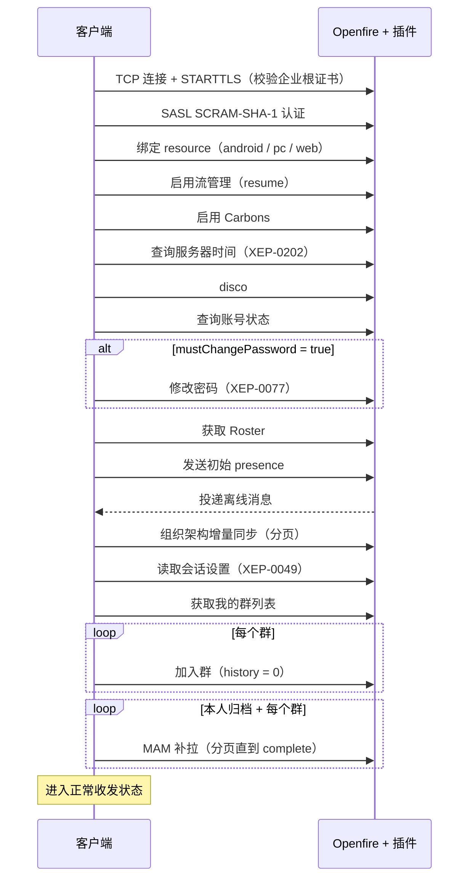

# 三端协议规范（Android / PC / Web / Openfire 插件）

> 版本：v0.1（草案）　日期：2026-10-13
>
> 本文档定义 IM 系统中客户端与服务端之间的通信约定。Android、PC、Web 三端客户端和 Openfire 自研插件**必须**共同遵守。
> 功能范围以《IM功能清单.md》为准；本文只覆盖 P0 / P1 功能的协议细节，P2 功能仅预留命名空间（见 §15）。

## 目录

- [0. 阅读约定](#0-阅读约定)
- [1. 基础约定](#1-基础约定)
- [2. 连接与登录](#2-连接与登录)
- [3. 账号](#3-账号)
- [4. 组织架构](#4-组织架构)
- [5. 常用联系人与在线状态](#5-常用联系人与在线状态)
- [6. 消息通用规则](#6-消息通用规则)
- [7. 消息内容类型](#7-消息内容类型)
- [8. 消息操作（回执、已读、撤回、引用、@）](#8-消息操作回执已读撤回引用)
- [9. 文件上传](#9-文件上传)
- [10. 群聊](#10-群聊)
- [11. 消息同步（多端与漫游）](#11-消息同步多端与漫游)
- [12. 音视频通话](#12-音视频通话)
- [13. 会话设置同步](#13-会话设置同步)
- [14. 公司公告与诊断上报](#14-公司公告与诊断上报)
- [15. 预留功能](#15-预留功能)
- [16. 错误码](#16-错误码)
- [附录 A：命名空间汇总](#附录-a命名空间汇总)
- [附录 B：登录时序](#附录-b登录时序)

---

## 0. 阅读约定

| 用词 | 含义 |
| --- | --- |
| **必须** | 不遵守则功能异常或三端不兼容 |
| **应该** | 强烈建议，有充分理由时可以例外 |
| **可以** | 可选 |

- 文中 `im.example.com` 为服务器域名占位符，部署时替换为实际专网域名。
- XML 示例中 `<!-- -->` 为说明性注释，实际报文中不出现。
- "插件"指本项目自研的 Openfire 插件，共两个：
  - **组织架构插件**（org）：账号状态、组织架构、在线状态查询、公司公告。
  - **业务扩展插件**（biz）：群聊扩展、撤回校验、敏感词过滤、诊断上报。

---

## 1. 基础约定

### 1.1 地址（JID）

| 对象 | 格式 | 示例 |
| --- | --- | --- |
| 用户 | `{工号}@im.example.com` | `10086@im.example.com` |
| 用户的某个端 | `{工号}@im.example.com/{端}` | `10086@im.example.com/android` |
| 群聊 | `{群ID}@conference.im.example.com` | `g3f2a9c1e5b7d4f6a8c0e2b4d6f8a0c2e@conference.im.example.com` |
| 文件上传服务 | `httpfileupload.im.example.com` | |
| 插件服务 | `im.example.com`（直接发往服务器域名） | |

- 工号即登录用户名，**必须**只包含小写字母、数字、`.`、`_`、`-`；导入时大写字母统一转小写。
- 端（resource）**必须**使用固定值：`android`、`pc`、`web`。同一端重复登录时，Openfire 踢掉旧连接（见 §2.4）。
- 群 ID 由创建方客户端生成：`g` + 去掉横线的小写 UUID（共 33 个字符）。

### 1.2 命名空间

- 自定义命名空间统一前缀：`urn:android666:im:`，格式为 `urn:android666:im:{模块}:{主版本号}`。
- 主版本号只在**不兼容变更**时递增；兼容性扩展（新增可选属性 / 子元素）不改版本号。
- 完整列表见附录 A。

### 1.3 ID

| ID | 生成方 | 格式 | 用途 |
| --- | --- | --- | --- |
| 消息 ID | 发送方客户端 | 小写 UUID v4（带横线） | 消息的**唯一标识**，回执、已读、撤回、引用、去重都用它 |
| stanza-id | 服务端（MAM） | 服务端决定 | **仅**用作消息漫游分页游标，不用于业务引用 |
| IQ ID | 发起方 | 任意唯一字符串 | 匹配请求和响应 |

> **本项目统一规则**：无论单聊还是群聊，所有对消息的引用（回执、已读、撤回、引用回复）**必须**使用发送方生成的消息 ID。
> 部分 XEP 建议群聊中使用 MUC 分配的 stanza-id，由于三端都是自研客户端，本项目统一用消息 ID，简化实现。

### 1.4 时间

- XML 中的时间**必须**使用 XEP-0082 格式，UTC 时区，精确到毫秒：`2026-10-13T02:30:00.000Z`。
- 消息时间**以服务器时间为准**：
  - 离线消息、漫游消息取 `<delay stamp>`（XEP-0203）。
  - 实时消息取"本地接收时间 + 时钟偏差"，时钟偏差在登录时通过 XEP-0202（Entity Time）向服务器查询得到。
- 消息排序：按服务器时间升序，时间相同时按接收顺序。

### 1.5 兼容与降级

- 收到**不认识的元素或属性必须忽略**，不能报错。
- 所有非文本消息**必须**带 `<body>` 降级文本（如 `[图片]`），保证旧版本客户端、消息审计、敏感词过滤能处理。
- 收到不认识的消息类型时，显示 `<body>` 内容；`<body>` 也没有时显示"[当前版本不支持该消息，请升级]"。

### 1.6 数量与长度限制

| 项目 | 上限 |
| --- | --- |
| 文本消息长度 | 5000 字符 |
| 普通群人数 | 500 人 |
| 合并转发条数 | 100 条 |
| 单个文件大小 | 100 MB（以文件上传服务返回的值为准，见 §9） |
| 语音消息时长 | 60 秒 |
| 批量查询（员工详情、在线状态） | 每次 100 个 |
| 群消息已读统计 | 每次 50 条消息 |
| 分页查询（RSM） | 每页最多 500 条 |

### 1.7 能力发现

- 客户端登录后**必须**向 `im.example.com` 发送 disco#info（XEP-0030），检查下表中的 feature 是否存在；不存在则隐藏相应功能。

| feature | 提供方 | 功能 |
| --- | --- | --- |
| `urn:android666:im:account:1` | org 插件 | 账号状态 |
| `urn:android666:im:org:1` | org 插件 | 组织架构 |
| `urn:android666:im:presence:1` | org 插件 | 在线状态查询 |
| `urn:android666:im:notice:1` | org 插件 | 公司公告 |
| `urn:android666:im:muc:1` | biz 插件 | 群聊扩展 |
| `urn:android666:im:diag:1` | biz 插件 | 诊断上报 |
| `urn:xmpp:mam:2` | Monitoring 插件 | 消息漫游 |
| `urn:xmpp:carbons:2` | Openfire | 多端同步 |
| `urn:xmpp:extdisco:2` | External Service Discovery 插件 | TURN 凭证 |

---

## 2. 连接与登录

### 2.1 连接方式

| 端 | 方式 | 地址 |
| --- | --- | --- |
| Android / PC | TCP + STARTTLS（**必须**启用 TLS，禁止明文） | `im.example.com:5222` |
| Web | WebSocket over TLS（RFC 7395） | `wss://im.example.com:7443/ws/` |

- 证书：服务器使用企业自建根证书签发的证书，客户端**必须**内置根证书并校验证书链和主机名（详见《IM功能清单.md》§18.2）。
- 认证：SASL `SCRAM-SHA-1`（Openfire 默认）；**禁止**降级为 `PLAIN` 等明文认证机制。

### 2.2 登录后必须执行的步骤

按顺序执行（完整时序见附录 B）：

1. 认证、绑定 resource（`android` / `pc` / `web`）。
2. 启用流管理（XEP-0198），请求 `resume='true'`。Web 端可以不启用。
3. 启用 Message Carbons（XEP-0280）。
4. 查询服务器时间（XEP-0202），计算时钟偏差。
5. 能力发现（§1.7）。
6. 查询账号状态（§3.1），如需强制改密则进入改密流程，暂停后续步骤。
7. 获取 Roster（常用联系人）。
8. 发送初始 presence（此时服务器开始投递离线消息）。
9. 组织架构增量同步（§4.4）。
10. 读取会话设置（§13）。
11. 获取我的群列表（§10.2），逐个加入群（§10.4）。
12. 消息漫游补拉（§11.2）。

### 2.3 保活与重连

| 项目 | 约定 |
| --- | --- |
| 心跳 | 客户端每 **60 秒**无收发数据时发送 XEP-0199 ping；10 秒内无响应视为断线。间隔可根据专网实测调整 |
| 流管理确认 | 客户端每发送 5 个 stanza 或每 30 秒发送一次 `<r/>` |
| 前后台 | 进入后台发送 XEP-0352 `<inactive/>`，回到前台发送 `<active/>` |
| 重连 | 断线后立即尝试一次，之后按 2、4、8、16、32、60 秒退避，上限 60 秒；网络恢复时立即重连。除第一次外，每次等待时间**应该**加入 ±20% 的随机抖动，避免服务器重启后上万终端在同一时刻重连 |
| 流恢复 | 优先使用 XEP-0198 resume 恢复会话（无需重新执行 §2.2 第 3 ~ 11 步，但仍需执行第 12 步补拉）；恢复失败则完整重新登录 |

### 2.4 被动下线

| 情况 | 服务器行为 | 客户端处理 |
| --- | --- | --- |
| 同一端在其他设备登录 | 发送 stream error `<conflict/>` | 提示"你的账号已在其他设备登录"，**不自动重连**，回到登录页 |
| 账号被管理员禁用 | org 插件关闭连接，stream error `<policy-violation/>` + `<account-disabled xmlns='urn:android666:im:error:1'/>` | 提示"账号已被禁用"，清除自动登录凭证，回到登录页 |
| 登录时密码错误 / 账号已禁用 | SASL 失败 `<not-authorized/>` | 提示"账号或密码错误，或账号已被禁用" |

```xml
<!-- 账号被禁用时服务器发送的 stream error -->
<stream:error>
  <policy-violation xmlns='urn:ietf:params:xml:ns:xmpp-streams'/>
  <account-disabled xmlns='urn:android666:im:error:1'/>
</stream:error>
```

---

## 3. 账号

### 3.1 查询账号状态

```xml
<!-- 客户端 → 服务器 -->
<iq type='get' id='a1' to='im.example.com'>
  <account xmlns='urn:android666:im:account:1'/>
</iq>

<!-- 服务器 → 客户端 -->
<iq type='result' id='a1' from='im.example.com'>
  <account xmlns='urn:android666:im:account:1'
           mustChangePassword='true'/>
</iq>
```

| 属性 | 类型 | 说明 |
| --- | --- | --- |
| mustChangePassword | boolean | 为 `true` 时客户端**必须**进入强制改密页面，改密成功前不进入主界面 |

- 服务器侧：`mustChangePassword='true'` 期间，org 插件**必须**拒绝该用户发出的所有 message（返回错误码 `must-change-password`），防止绕过客户端限制。

### 3.2 修改密码

使用 XEP-0077 标准报文，org 插件监听到改密成功后清除 `mustChangePassword` 标记。

```xml
<iq type='set' id='a2' to='im.example.com'>
  <query xmlns='jabber:iq:register'>
    <username>10086</username>
    <password>新密码</password>
  </query>
</iq>
```

- Openfire 需关闭"允许自助注册"、开启"允许用户修改密码"。
- 密码规则（由 org 插件校验，不满足时返回 `not-acceptable` + 错误码 `weak-password`）：8 ~ 32 位，至少包含字母和数字。
- 改密成功后，客户端**必须**用新密码更新本地保存的凭证。

---

## 4. 组织架构

> 部门树和员工信息由 org 插件维护（Excel 导入 + 管理后台），客户端只读。
> 客户端策略：Android / PC **应该**做全量缓存 + 增量同步，搜索可在本地完成；Web 端**可以**只按需加载（§4.2、§4.5）。

### 4.1 数据结构

**部门 `<department>`**

| 属性 | 类型 | 说明 |
| --- | --- | --- |
| id | string | 部门 ID，服务器生成 |
| parentId | string | 上级部门 ID，顶级部门为空字符串 |
| name | string | 部门名称 |
| sort | int | 同级排序，升序 |
| memberCount | int | 直属成员数（不含子部门） |
| op | string | 仅出现在同步结果中：`upsert`（新增或更新）/ `delete`（删除） |

**员工 `<employee>`**

| 属性 | 类型 | 说明 |
| --- | --- | --- |
| jid | string | 用户 JID（bare） |
| empNo | string | 工号（等于 JID 的用户名部分） |
| name | string | 姓名 |
| pinyin | string | 姓名全拼，小写无空格，如 `zhangsan`；多音字由服务器取常用读音 |
| initials | string | 拼音首字母，如 `zs` |
| deptId | string | 所属部门 ID |
| title | string | 职位，可为空 |
| mobile | string | 手机，可为空 |
| phone | string | 座机，可为空 |
| email | string | 邮箱，可为空 |
| sort | int | 部门内排序，升序 |
| avatarHash | string | 头像的 SHA-1（与 XEP-0153 一致），无头像时为空；变化时客户端重新拉取 vCard 头像 |
| op | string | 仅出现在同步结果中：`upsert` / `delete`（离职、禁用都视为 `delete`） |

### 4.2 获取部门下级（按需加载）

```xml
<iq type='get' id='o1' to='im.example.com'>
  <dept-children xmlns='urn:android666:im:org:1' deptId='d1001'>
    <!-- 员工列表分页；部门列表不分页 -->
    <set xmlns='http://jabber.org/protocol/rsm'><max>200</max></set>
  </dept-children>
</iq>

<iq type='result' id='o1' from='im.example.com'>
  <dept-children xmlns='urn:android666:im:org:1' deptId='d1001'>
    <department id='d1002' parentId='d1001' name='Android组' sort='10' memberCount='25'/>
    <department id='d1003' parentId='d1001' name='iOS组' sort='20' memberCount='18'/>
    <employee jid='10086@im.example.com' empNo='10086' name='张三' pinyin='zhangsan'
              initials='zs' deptId='d1001' title='部门经理' mobile='13800000000'
              phone='' email='zhangsan@example.com' sort='0' avatarHash='a1b2c3...'/>
    <set xmlns='http://jabber.org/protocol/rsm'>
      <first>0</first><last>0</last><count>1</count>
    </set>
  </dept-children>
</iq>
```

- `deptId` 为空字符串时返回所有顶级部门。

### 4.3 批量获取员工详情

用于消息列表、群成员等场景补全姓名和头像（本地缓存未命中时）。

```xml
<iq type='get' id='o2' to='im.example.com'>
  <employees xmlns='urn:android666:im:org:1'>
    <item jid='10086@im.example.com'/>
    <item jid='10087@im.example.com'/>
  </employees>
</iq>

<iq type='result' id='o2' from='im.example.com'>
  <employees xmlns='urn:android666:im:org:1'>
    <employee jid='10086@im.example.com' ... />
    <!-- 不存在或已离职的员工：返回 op='delete'，客户端显示为"已离职" -->
    <employee jid='10087@im.example.com' op='delete'/>
  </employees>
</iq>
```

### 4.4 组织架构同步（全量 / 增量）

- 服务器维护一个全局递增的**组织架构版本号**，任何部门或员工变更都会使其加 1。
- 客户端本地保存上次同步完成时的版本号。首次登录时版本号为 `0`，即全量同步。

```xml
<!-- 客户端 → 服务器：携带本地版本号 -->
<iq type='get' id='o3' to='im.example.com'>
  <sync xmlns='urn:android666:im:org:1' version='1520'>
    <set xmlns='http://jabber.org/protocol/rsm'><max>500</max></set>
  </sync>
</iq>

<!-- 服务器 → 客户端 -->
<iq type='result' id='o3' from='im.example.com'>
  <sync xmlns='urn:android666:im:org:1' version='1536' full='false'>
    <department id='d1004' parentId='d1001' name='测试组' sort='30' memberCount='0' op='upsert'/>
    <employee jid='10099@im.example.com' ... op='upsert'/>
    <employee jid='10050@im.example.com' op='delete'/>
    <set xmlns='http://jabber.org/protocol/rsm'>
      <first>c-0</first><last>c-2</last><count>3</count>
    </set>
  </sync>
</iq>
```

| 属性 | 说明 |
| --- | --- |
| version（响应） | 本次同步完成后客户端应保存的版本号 |
| full（响应） | `true` 表示服务器无法提供增量（本地版本为 0 或过旧），本次返回全量数据，客户端**必须**先清空本地组织架构缓存再写入 |

规则：

- 分页：客户端用 RSM `<after>{last}</after>` 继续拉取下一页，直到返回条数为 0。所有页面返回相同的 `version` 和 `full`。
- **只有所有页面拉取完成后**才更新本地版本号；中途失败则下次从旧版本号重新同步。
- 服务器保留最近 30 天的变更记录，更早的版本号返回 `full='true'`。
- 触发时机：登录后、App 回到前台（距上次同步超过 10 分钟）、用户下拉刷新通讯录。
- 服务器**不主动推送**组织架构变更（1 万人广播代价过高）。

### 4.5 搜索同事

Android / PC 已有全量缓存时**应该**在本地搜索；Web 端使用此接口。

```xml
<iq type='get' id='o4' to='im.example.com'>
  <search xmlns='urn:android666:im:org:1' keyword='zs'>
    <set xmlns='http://jabber.org/protocol/rsm'><max>20</max></set>
  </search>
</iq>
```

- 匹配字段：姓名、全拼、首字母、工号、手机号、部门名称（前缀或包含匹配）。
- 结果为 `<employee>` 列表，按匹配度排序。

---

## 5. 常用联系人与在线状态

### 5.1 常用联系人（Roster）

- 常用联系人 = 本人 Roster 中订阅状态为 `to` 或 `both` 的条目；只有 `from` 的条目**不显示**。
- 添加：客户端发送 roster set（Roster 名称留空，显示名一律取组织架构姓名）+ `<presence type='subscribe'/>`。
- **订阅请求由 org 插件在服务器端自动同意**（企业内部无需对方确认，对方离线也能立即生效），客户端不显示"好友申请"。
- 移除：发送 roster remove。

### 5.2 发送在线状态

```xml
<presence>
  <show>dnd</show>                  <!-- 省略 = 在线；away = 离开；dnd = 忙碌 -->
  <status>下午 3 点前在开会</status>  <!-- 自定义文字，可选 -->
  <state xmlns='urn:android666:im:presence:1' code='meeting'/>
  <c xmlns='http://jabber.org/protocol/caps' hash='sha-1' node='...' ver='...'/>
</presence>
```

| code | 显示 | 对应 show |
| --- | --- | --- |
| （无 state 元素） | 在线 | 省略 |
| `busy` | 忙碌 | `dnd` |
| `meeting` | 开会中 | `dnd` |
| `business-trip` | 出差 | `away` |
| `away` | 离开 | `away` |

- `code` 用于显示图标；不认识的 `code` 按 `show` 显示。

### 5.3 查询任意同事在线状态

不订阅也能查询，用于资料卡、单聊页顶部。

```xml
<iq type='get' id='p1' to='im.example.com'>
  <presence-query xmlns='urn:android666:im:presence:1'>
    <item jid='10086@im.example.com'/>
    <item jid='10087@im.example.com'/>
  </presence-query>
</iq>

<iq type='result' id='p1' from='im.example.com'>
  <presence-query xmlns='urn:android666:im:presence:1'>
    <item jid='10086@im.example.com' online='true'>
      <resource name='android' show='dnd' status='下午 3 点前在开会' code='meeting'/>
      <resource name='pc'/>
    </item>
    <item jid='10087@im.example.com' online='false' lastActive='2026-10-13T01:20:00.000Z'/>
  </presence-query>
</iq>
```

- 客户端**应该**缓存结果 60 秒，避免频繁查询。

---

## 6. 消息通用规则

### 6.1 消息结构

```xml
<message type='chat' id='5b1e...' to='10087@im.example.com'>
  <!-- 降级文本，所有消息必须有 -->
  <body>你好</body>
  <!-- 消息 ID，必须与 message@id 相同（XEP-0359） -->
  <origin-id xmlns='urn:xmpp:sid:0' id='5b1e...'/>
  <!-- 消息内容；缺省表示纯文本 -->
  <content xmlns='urn:android666:im:msg:1' type='text'/>
  <!-- 单聊：请求送达回执（XEP-0184） -->
  <request xmlns='urn:xmpp:receipts'/>
  <!-- 可标记已读（XEP-0333） -->
  <markable xmlns='urn:xmpp:chat-markers:0'/>
</message>
```

| 规则 | 说明 |
| --- | --- |
| type | 单聊 `chat`，群聊 `groupchat` |
| id | 消息 ID（§1.3），**必须**与 `origin-id` 相同 |
| body | **必须**存在（§1.5） |
| content | 自定义内容元素，`type` 取值见 §7；缺省等同于 `type='text'` |
| request | 单聊消息**必须**带；群聊不带 |
| markable | 用户可见的消息**必须**带；信令、系统事件不带 |

### 6.2 消息发送状态

| 状态 | 判定条件 |
| --- | --- |
| 发送中 | 已写入发送队列 |
| 已发送 | 收到 XEP-0198 `<a/>` 确认（Web 端未启用流管理时：群聊收到 MUC 回显，单聊直接视为已发送） |
| 已送达 | 收到对方 XEP-0184 `<received/>`（仅单聊） |
| 已读 | 收到对方 XEP-0333 `<displayed/>`（单聊），或群已读统计（§10.7） |
| 发送失败 | 服务器返回 error，或 30 秒内未确认；客户端显示红色感叹号，可手动重发（**必须**沿用原消息 ID） |

### 6.3 去重

离线消息、Carbons、MAM 补拉、重发可能导致同一条消息到达多次。客户端**必须**按"会话 + 消息 ID"去重，重复的消息直接丢弃。

### 6.4 服务端过滤（敏感词）

- biz 插件检查所有 `chat` / `groupchat` 消息的 `<body>`，命中敏感词时**拒绝投递**，向发送方返回错误：

```xml
<message type='error' id='5b1e...' from='10087@im.example.com'>
  <error type='modify'>
    <policy-violation xmlns='urn:ietf:params:xml:ns:xmpp-stanzas'/>
    <app-error xmlns='urn:android666:im:error:1' code='sensitive-word'/>
  </error>
</message>
```

- 客户端将该消息标为发送失败，并提示"消息包含敏感内容，发送失败"。

---

## 7. 消息内容类型

所有类型都放在 `<content xmlns='urn:android666:im:msg:1' type='...'>` 中。

| type | 说明 | body 降级文本 |
| --- | --- | --- |
| `text` | 文本（可省略 content 元素） | 原文 |
| `image` | 图片 | `[图片]` |
| `voice` | 语音 | `[语音]` |
| `video` | 视频 | `[视频]` |
| `file` | 文件 | `[文件] {文件名}` |
| `card` | 同事名片 | `[名片] {姓名}` |
| `merged` | 合并转发 | `[聊天记录] {标题}` |
| `call` | 通话记录 | `[语音通话] {结果}` / `[视频通话] {结果}` |
| `custom` | 业务卡片（预留） | 由业务定义 |

### 7.1 文件描述 `<file>`（图片、语音、视频、文件共用）

| 属性 | 类型 | 必填 | 说明 |
| --- | --- | --- | --- |
| url | string | 是 | 下载地址（来自 §9 上传结果） |
| name | string | 是 | 原始文件名 |
| size | long | 是 | 字节数 |
| mime | string | 是 | MIME 类型 |
| sha256 | string | 否 | 文件 SHA-256，下载后可校验 |
| width / height | int | 图片、视频必填 | 像素 |
| duration | int | 语音、视频必填 | 时长，毫秒 |

缩略图 `<thumbnail>`（图片、视频必填）：属性 `url`、`width`、`height`、`mime`。

### 7.2 图片

```xml
<body>[图片]</body>
<content xmlns='urn:android666:im:msg:1' type='image' original='false'>
  <file url='https://im.example.com:7443/httpfileupload/.../a.jpg' name='a.jpg'
        size='245760' mime='image/jpeg' width='1920' height='1080'/>
  <thumbnail url='https://im.example.com:7443/httpfileupload/.../a_thumb.jpg'
             width='320' height='180' mime='image/jpeg'/>
</content>
```

| 规则 | 约定 |
| --- | --- |
| 压缩 | 非原图：长边 ≤ 1920 像素，JPEG 质量 80；GIF 不压缩 |
| 原图 | `original='true'`，不压缩，但仍受文件大小上限约束 |
| 缩略图 | 长边 ≤ 320 像素，JPEG，≤ 30 KB；先上传缩略图再上传原图，两次上传都成功后才发送消息 |

### 7.3 语音

```xml
<body>[语音]</body>
<content xmlns='urn:android666:im:msg:1' type='voice'>
  <file url='...' name='voice.m4a' size='16384' mime='audio/mp4' duration='5300'/>
</content>
```

- 编码**必须**为 AAC-LC，16 kHz，单声道，32 kbps，容器 m4a（三端均可直接播放）。
- 时长 1 ~ 60 秒，不足 1 秒不发送。

### 7.4 视频

```xml
<body>[视频]</body>
<content xmlns='urn:android666:im:msg:1' type='video'>
  <file url='...' name='v.mp4' size='5242880' mime='video/mp4'
        width='1280' height='720' duration='15000'/>
  <thumbnail url='...' width='320' height='180' mime='image/jpeg'/>
</content>
```

- 编码**必须**为 H.264 + AAC，容器 MP4；发送前压缩到长边 ≤ 1280 像素。

### 7.5 文件

```xml
<body>[文件] 季度报告.pdf</body>
<content xmlns='urn:android666:im:msg:1' type='file'>
  <file url='...' name='季度报告.pdf' size='1048576' mime='application/pdf' sha256='...'/>
</content>
```

### 7.6 名片

```xml
<body>[名片] 张三</body>
<content xmlns='urn:android666:im:msg:1' type='card'>
  <card jid='10086@im.example.com' name='张三'/>
</content>
```

- 接收方显示时**应该**以本地组织架构中的最新信息为准，`name` 仅作缓存未命中时的兜底。

### 7.7 合并转发

```xml
<body>[聊天记录] 张三和李四的聊天记录</body>
<content xmlns='urn:android666:im:msg:1' type='merged' title='张三和李四的聊天记录'>
  <forwarded xmlns='urn:xmpp:forward:0'>
    <delay xmlns='urn:xmpp:delay' stamp='2026-10-13T01:00:00.000Z'/>
    <message type='chat' id='...' from='10086@im.example.com' to='10087@im.example.com'>
      <body>原始消息内容</body>
      <!-- 原消息的 content 元素原样保留 -->
    </message>
  </forwarded>
  <!-- 更多 forwarded，最多 100 条 -->
</content>
```

- 合并转发中的消息**不能**再被撤回、引用；文件类消息直接复用原 URL。
- **逐条转发**不使用此结构：逐条生成新消息（新消息 ID），内容复制原消息。

### 7.8 通话记录

```xml
<body>[视频通话] 通话时长 03:25</body>
<content xmlns='urn:android666:im:msg:1' type='call'>
  <call callId='c-7f3a...' media='video' result='completed' duration='205'/>
</content>
```

| 属性 | 说明 |
| --- | --- |
| callId | 对应 §12 中的通话 ID |
| media | `audio` / `video` |
| result | `completed` 已接通 / `canceled` 主叫取消 / `rejected` 被叫拒绝 / `missed` 无人接听 / `busy` 对方忙 / `failed` 连接失败 |
| duration | 通话时长（秒），仅 `completed` 时有值 |

- 通话结束后由**主叫方**发送此消息（单聊 `chat`），双方和各自的其他端都通过普通消息流程收到并显示。

---

## 8. 消息操作（回执、已读、撤回、引用、@）

### 8.1 送达回执（仅单聊）

接收方客户端收到带 `<request/>` 的消息并**写入本地数据库后**，立即回复：

```xml
<message to='10086@im.example.com' id='r-...'>
  <received xmlns='urn:xmpp:receipts' id='5b1e...'/>
  <no-store xmlns='urn:xmpp:hints'/>
</message>
```

- 通过 MAM 补拉到的历史消息**不发送**送达回执。

### 8.2 已读（单聊）

用户打开会话并看到消息时，对**最新一条**对方发来的可标记消息发送：

```xml
<message type='chat' to='10086@im.example.com' id='m-...'>
  <displayed xmlns='urn:xmpp:chat-markers:0' id='5b1e...'/>
  <store xmlns='urn:xmpp:hints'/>
</message>
```

- 语义：该消息**及之前的所有消息**都已读。
- 带 `<store/>` 使其进入 MAM 存档，发送方离线时上线后也能拿到已读状态。
- 本人其他端通过 Carbons 收到这条 `displayed`，据此清除该会话未读数（多端已读同步）。
- 群聊已读见 §10.7，**不**在群里广播 `displayed`。

### 8.3 正在输入（仅单聊）

- 使用 XEP-0085 的 `composing` / `paused` 状态，带 `<no-store xmlns='urn:xmpp:hints'/>`。
- 同一会话每 5 秒最多发送一次 `composing`；停止输入 5 秒后发送 `paused`。
- 群聊**不发送**正在输入状态。

### 8.4 撤回

```xml
<message type='chat' to='10087@im.example.com' id='x-...'>
  <body>张三撤回了一条消息</body>
  <retract xmlns='urn:xmpp:message-retract:1' id='5b1e...'/>
  <fallback xmlns='urn:xmpp:fallback:0' for='urn:xmpp:message-retract:1'/>
  <store xmlns='urn:xmpp:hints'/>
</message>
```

| 规则 | 约定 |
| --- | --- |
| 时限 | 普通用户只能撤回自己 **2 分钟内**发送的消息 |
| 群管理 | 群主、管理员可以撤回群内任何人的消息，不限时 |
| 服务器校验 | biz 插件记录每条消息的发送方和服务器时间，不满足条件时拒绝，返回错误码 `retract-timeout` / `retract-forbidden` |
| 接收方 | 将原消息替换为"xx 撤回了一条消息"；原消息未收到时也要记录撤回，防止之后补拉到原消息时又显示出来 |
| 漫游 | MAM 中原消息和撤回消息都存在，客户端补拉时**必须**先应用撤回 |
| 审计 | 服务器存档保留原消息，管理员审计时可见 |

### 8.5 引用回复

```xml
<message type='chat' to='10087@im.example.com' id='...'>
  <body>好的，我下午处理</body>
  <reply xmlns='urn:xmpp:reply:0' to='10087@im.example.com' id='5b1e...'/>
  <content xmlns='urn:android666:im:msg:1' type='text'/>
</message>
```

- `reply@to`：被引用消息的发送方 bare JID；`reply@id`：被引用消息的消息 ID。
- 客户端从本地库查找原消息显示引用预览；找不到时显示"原消息不可见"；原消息已撤回时显示"原消息已撤回"。

### 8.6 @ 提醒（仅群聊）

```xml
<message type='groupchat' to='g...@conference.im.example.com' id='...'>
  <body>@张三 @所有人 下午开会</body>
  <reference xmlns='urn:xmpp:reference:0' type='mention' begin='0' end='3'
             uri='xmpp:10086@im.example.com'/>
  <reference xmlns='urn:xmpp:reference:0' type='mention' begin='4' end='8'
             uri='xmpp:g...@conference.im.example.com'/>
</message>
```

- `uri` 为用户 JID 表示 @某人；为**群 JID** 表示 @所有人。
- **只有群主和管理员**可以 @所有人，biz 插件校验，不满足时返回错误码 `mention-all-forbidden`。
- `begin` / `end` 按 **Unicode 码点**计数（XEP-0372 规定），**不是** UTF-16 下标：Java / Kotlin / JavaScript 中 emoji 等字符占 2 个 `char`，计算时必须转换。
- 被 @ 的用户：会话列表显示"[有人@我]"，即使群设置了免打扰也要通知。

---

## 9. 文件上传

使用 XEP-0363（HTTP File Upload 插件）。

```xml
<!-- 1. 申请上传槽位 -->
<iq type='get' id='u1' to='httpfileupload.im.example.com'>
  <request xmlns='urn:xmpp:http:upload:0' filename='a.jpg' size='245760' content-type='image/jpeg'/>
</iq>

<!-- 2. 服务器返回上传地址和下载地址 -->
<iq type='result' id='u1' from='httpfileupload.im.example.com'>
  <slot xmlns='urn:xmpp:http:upload:0'>
    <put url='https://im.example.com:7443/httpfileupload/.../a.jpg'/>
    <get url='https://im.example.com:7443/httpfileupload/.../a.jpg'/>
  </slot>
</iq>

<!-- 3. 客户端 HTTP PUT 上传文件到 put url，成功后把 get url 填入消息的 file@url -->
```

| 规则 | 约定 |
| --- | --- |
| 大小上限 | 登录后通过 disco#info 查询上传服务的 `max-file-size`，超过时客户端直接提示，不申请槽位 |
| 文件名 | 上传时文件名改为 `{UUID}.{扩展名}`，原始文件名放在消息的 `file@name` 中（避免中文和特殊字符问题） |
| 失败重试 | 上传失败可重试 3 次；重试时重新申请槽位 |
| 下载 | 下载地址无需额外鉴权（URL 不可猜测，且只在专网内可访问）；HTTP 404 时显示"文件已过期或被清理" |
| 证书 | 上传 / 下载**必须**使用与 XMPP 连接相同的证书信任配置 |

---

## 10. 群聊

使用 XEP-0045（MUC），由 biz 插件补充"我的群列表、系统事件、已读统计"等能力。

### 10.1 群配置

创建群时，创建方**必须**提交以下房间配置（XEP-0045 owner 配置表单）：

| 字段 | 值 | 说明 |
| --- | --- | --- |
| `muc#roomconfig_roomname` | 群名称 | |
| `muc#roomconfig_persistentroom` | `1` | 持久化 |
| `muc#roomconfig_membersonly` | `1` | 仅成员可进入 |
| `muc#roomconfig_whois` | `anyone` | 非匿名，所有人可见真实 JID |
| `muc#roomconfig_publicroom` | `0` | 不在公开列表中显示 |
| `muc#roomconfig_maxusers` | `500` | 人数上限 |
| `muc#roomconfig_changesubject` | `0` | 只有群主 / 管理员可改群公告 |
| `muc#roomconfig_allowinvites` | `1` | 普通成员可以邀请 |
| `muc#roomconfig_presencebroadcast` | `moderator` | **减少在线状态广播**：普通成员进群时不再收到所有成员的 presence，大幅降低登录流量 |
| `muc#roomconfig_historylength` | `0` | 不使用 MUC 自带历史，历史消息走 MAM |

- 群昵称（nick）**必须**使用本人工号，显示名一律取组织架构中的姓名。

### 10.2 我的群列表

以 biz 插件返回的列表为准（**不使用** Bookmarks），避免被移出群后本地书签残留。

```xml
<iq type='get' id='g1' to='im.example.com'>
  <rooms xmlns='urn:android666:im:muc:1'/>
</iq>

<iq type='result' id='g1' from='im.example.com'>
  <rooms xmlns='urn:android666:im:muc:1'>
    <room jid='g3f2a...@conference.im.example.com' name='Android 开发组'
          subject='本周五发版' affiliation='owner' memberCount='25'/>
  </rooms>
</iq>
```

- 返回本人为 owner / admin / member 的所有群。
- 客户端以此列表为准：本地有、列表中没有的群，标记为"已退出"（保留聊天记录，不再加入）。

### 10.3 创建群

1. 生成群 ID（§1.1），发送 presence 进入 `{群JID}/{工号}`，Openfire 创建房间。
2. 提交 §10.1 的房间配置。
3. 一次性设置所有初始成员的 affiliation 为 `member`（XEP-0045 admin IQ）。
4. biz 插件校验人数（含创建者 ≤ 500，超过时返回错误码 `room-full`），并在群内产生 `created` 事件（§10.6）。
5. 其他成员在线时收到事件消息，自动刷新群列表并加入；离线成员上线后通过 §10.2 获得。

> 不使用 XEP-0249 邀请消息：成员身份由 affiliation 决定，事件消息已足够通知。

### 10.4 加入群（登录后）

```xml
<presence to='g3f2a...@conference.im.example.com/10086'>
  <x xmlns='http://jabber.org/protocol/muc'>
    <history maxstanzas='0'/>   <!-- 不要 MUC 历史，改用 MAM 补拉 -->
  </x>
</presence>
```

- 加入成功后，按 §11.2 对该群执行 MAM 补拉。
- 重连且流恢复失败时，**必须**重新加入所有群。

### 10.5 群管理操作

| 操作 | 实现 | 权限 |
| --- | --- | --- |
| 邀请成员 | 设置 affiliation = `member` | 所有成员 |
| 移除成员 | 设置 affiliation = `none` | 群主、管理员（管理员不能移除群主和其他管理员） |
| 退出群 | 本人设置自己 affiliation = `none`，然后离开房间 | 群主须先转让 |
| 设置 / 取消管理员 | affiliation = `admin` / `member` | 群主 |
| 转让群主 | 新群主 affiliation = `owner`，原群主改为 `admin` | 群主 |
| 修改群名称 | 提交房间配置 `muc#roomconfig_roomname` | 群主、管理员 |
| 修改群公告 | 发送 `<subject>` | 群主、管理员 |
| 解散群 | XEP-0045 destroy | 群主 |

- 群头像：默认由客户端用前 9 名成员头像合成，不需要服务器参与；自定义群头像为 P2。

### 10.6 群系统事件

所有成员变化、群资料变化，由 biz 插件**以群的名义**发出一条群消息，进入 MAM 存档，离线成员补拉时也能看到。客户端**不得**自己发送事件消息。

```xml
<message type='groupchat' from='g3f2a...@conference.im.example.com' id='e-...'>
  <body>张三邀请李四、王五加入了群聊</body>
  <event xmlns='urn:android666:im:muc:1' type='member-added' actor='10086@im.example.com'>
    <target jid='10087@im.example.com'/>
    <target jid='10088@im.example.com'/>
  </event>
</message>
```

| type | 含义 | 附加内容 |
| --- | --- | --- |
| `created` | 创建群 | target = 初始成员 |
| `member-added` | 邀请入群 | target = 新成员 |
| `member-removed` | 被移出群 | target = 被移出的成员 |
| `member-left` | 主动退群 | actor = 退群者 |
| `admin-added` / `admin-removed` | 设置 / 取消管理员 | target |
| `owner-transferred` | 转让群主 | target = 新群主 |
| `name-changed` | 修改群名称 | `<name>新名称</name>` |
| `subject-changed` | 修改群公告 | `<subject>新公告</subject>` |
| `destroyed` | 解散 | — |

- 客户端收到 `member-added` 且 target 包含自己时，刷新群列表并加入该群；收到 `member-removed` 且包含自己、或 `destroyed` 时，标记该群为"已退出"。

### 10.7 群消息已读统计

**上报已读位置**（用户看到群内最新消息时，同一个群每 3 秒最多上报一次）：

```xml
<iq type='set' id='g2' to='im.example.com'>
  <read xmlns='urn:android666:im:muc:1' room='g3f2a...@conference.im.example.com' id='{最新可见消息ID}'/>
</iq>
```

- 语义：该消息及之前的所有消息都已读。
- biz 插件记录"每人在每个群的已读时间点"，并向本人的**其他端**发送已读同步：

```xml
<message type='headline' to='10086@im.example.com'>
  <read xmlns='urn:android666:im:muc:1' room='g3f2a...@conference.im.example.com' id='...'/>
</message>
```

**查询已读人数**（发送方查看自己发出的消息，打开聊天页和下拉时查询，批量最多 50 条）：

```xml
<iq type='get' id='g3' to='im.example.com'>
  <read-stats xmlns='urn:android666:im:muc:1' room='g3f2a...@conference.im.example.com'>
    <msg id='5b1e...'/>
    <msg id='6c2f...'/>
  </read-stats>
</iq>

<iq type='result' id='g3' from='im.example.com'>
  <read-stats xmlns='urn:android666:im:muc:1' room='g3f2a...@conference.im.example.com'>
    <msg id='5b1e...' read='20' unread='4'/>
    <msg id='6c2f...' read='3' unread='21'/>
  </read-stats>
</iq>
```

**查询已读 / 未读名单**：

```xml
<iq type='get' id='g4' to='im.example.com'>
  <read-list xmlns='urn:android666:im:muc:1' room='...' id='5b1e...' type='unread'>
    <set xmlns='http://jabber.org/protocol/rsm'><max>100</max></set>
  </read-list>
</iq>
<!-- 结果：<item jid='...'/> 列表 + RSM -->
```

- 统计范围：消息发送时已在群内的成员（不含发送者本人）。
- 只有消息发送者本人可以查询，否则返回错误码 `forbidden`。

---

## 11. 消息同步（多端与漫游）

### 11.1 多端实时同步

- 单聊：依靠 Message Carbons（XEP-0280）。本人在 A 端发出 / 收到的单聊消息，会抄送给 B 端。
- 群聊：MUC 天然会把消息发给本人所有在线端。
- 不需要抄送的消息（信令等）**必须**带 `<private xmlns='urn:xmpp:carbons:2'/>` 和 `<no-copy xmlns='urn:xmpp:hints'/>`。
- **文件传输助手**：发给本人 bare JID 的单聊消息；发送端本地直接显示，其他端通过 Carbons / 路由收到，按消息 ID 去重。

### 11.2 补拉（MAM）

每次登录 / 重连后，对**单聊**（查询本人归档）和**每个已加入的群**（查询群归档）分别补拉：

```xml
<!-- 单聊：查询本人归档，从上次记录的游标之后开始 -->
<iq type='set' id='m1'>
  <query xmlns='urn:xmpp:mam:2' queryid='q1'>
    <set xmlns='http://jabber.org/protocol/rsm'>
      <max>100</max>
      <after>{本地保存的最后 stanza-id}</after>
    </set>
  </query>
</iq>

<!-- 群聊：to 为群 JID -->
<iq type='set' id='m2' to='g3f2a...@conference.im.example.com'>
  <query xmlns='urn:xmpp:mam:2' queryid='q2'> ... </query>
</iq>
```

| 规则 | 约定 |
| --- | --- |
| 游标 | 客户端按"本人归档 / 每个群"分别保存最后一条 stanza-id |
| 循环 | 每页 100 条，直到 `<fin complete='true'>` |
| 游标缺失 | 首次登录、或实时消息不带 stanza-id 导致游标落后时，改用时间过滤：`start` = 本地最后一条消息时间 − 5 分钟，再依赖 §6.3 去重 |
| 首次登录 | 每个会话只拉取最近 7 天或最近 200 条（先到为准），更早的在用户上滑时按需加载 |
| 历史分页 | 聊天页上滑时，用 RSM `<before>{当前最早 stanza-id}</before>` 向前加载 |
| 处理顺序 | 补拉结果按时间顺序处理，撤回（§8.4）、已读（§8.2）、群事件（§10.6）同样生效 |
| 不发回执 | 补拉到的消息不发送送达回执（§8.1） |

### 11.3 离线消息

- Openfire 离线消息照常开启：发送初始 presence 后，服务器投递离线消息。离线消息与 MAM 补拉内容会重复，靠 §6.3 去重。

---

## 12. 音视频通话

> **方案说明**：不使用 Jingle（XEP-0166/0167）。三端都是自研客户端，且都基于 WebRTC（Android 使用 libwebrtc，Web 使用浏览器原生 WebRTC），直接传递 SDP 比 Jingle ↔ SDP 互转简单可靠得多。
> 信令走 XMPP，媒体走 WebRTC（P2P 或经 coturn 中继）。

### 12.1 获取 TURN 凭证

每次发起或接听通话前查询（XEP-0215），凭证有效期内可复用：

```xml
<iq type='get' id='t1' to='im.example.com'>
  <services xmlns='urn:xmpp:extdisco:2'/>
</iq>

<iq type='result' id='t1' from='im.example.com'>
  <services xmlns='urn:xmpp:extdisco:2'>
    <service type='stun' host='turn.im.example.com' port='3478' transport='udp'/>
    <service type='turn' host='turn.im.example.com' port='3478' transport='udp'
             username='1760342400:10086%40im.example.com' password='...' expires='2026-10-14T02:00:00.000Z'/>
  </services>
</iq>
```

- 凭证由 External Service Discovery 插件按 TURN REST API 生成，有效期 24 小时：`username` = `{过期时间戳（秒）}:{URL 编码的 bare JID}`，`password` = Base64(HMAC-SHA1(共享密钥, username))。
- 客户端**必须**原样使用 `username` 和 `password`，不要自行解析或拼接。

### 12.2 媒体参数

| 项目 | 约定 |
| --- | --- |
| 音频 | Opus |
| 视频 | H.264（优先，便于硬件编解码）、VP8（兜底） |
| 分辨率 | 默认 640×480 / 15 fps；网络良好时可升到 1280×720 |
| 加密 | WebRTC 默认 DTLS-SRTP |
| ICE | 支持 Trickle ICE；专网终端隔离时会走 TURN 中继 |

### 12.3 信令一览（命名空间 `urn:android666:im:call:1`）

**呼叫控制**使用 message（可能需要通知对方多个端）：

| action | 方向 | 发送目标 | 说明 |
| --- | --- | --- | --- |
| `invite` | 主叫 → 被叫 | 被叫 **bare JID**（所有端同时响铃） | 发起呼叫 |
| `ringing` | 被叫 → 主叫 | 主叫 full JID | 已响铃 |
| `accept` | 被叫 → 主叫 | 主叫 full JID | 接听；被叫其他端通过 Carbons 收到后停止响铃，显示"已在其他设备接听" |
| `reject` | 被叫 → 主叫 | 主叫 full JID | 拒接；被叫其他端通过 Carbons 收到后停止响铃 |
| `busy` | 被叫 → 主叫 | 主叫 full JID | 被叫正在通话中，自动回复 |
| `cancel` | 主叫 → 被叫 | 被叫 bare JID | 接通前取消；60 秒无人接听时主叫也发送此消息 |
| `hangup` | 任一方 → 对方 | 对方 full JID | 接通后挂断 |

**媒体协商**使用 IQ，在双方 full JID 之间点对点发送（有确认，不经过其他端）：

| action | 说明 |
| --- | --- |
| `offer` | 主叫在收到 `accept` 后发送 SDP offer |
| `answer` | 被叫回复 SDP answer |
| `candidate` | 双方交换 ICE candidate |

### 12.4 报文示例

```xml
<!-- 发起呼叫 -->
<message type='chat' to='10087@im.example.com' id='...'>
  <call xmlns='urn:android666:im:call:1' action='invite' callId='c-7f3a...'
        media='video' ts='2026-10-13T02:30:00.000Z'/>
  <no-store xmlns='urn:xmpp:hints'/>
</message>

<!-- 接听（被叫其他端通过 Carbons 得知） -->
<message type='chat' to='10086@im.example.com/android' id='...'>
  <call xmlns='urn:android666:im:call:1' action='accept' callId='c-7f3a...'/>
  <no-store xmlns='urn:xmpp:hints'/>
</message>

<!-- SDP offer -->
<iq type='set' id='c1' to='10087@im.example.com/pc'>
  <call xmlns='urn:android666:im:call:1' action='offer' callId='c-7f3a...'>
    <sdp>v=0 ...</sdp>
  </call>
</iq>

<!-- ICE candidate -->
<iq type='set' id='c2' to='10086@im.example.com/android'>
  <call xmlns='urn:android666:im:call:1' action='candidate' callId='c-7f3a...'>
    <candidate sdpMid='0' sdpMLineIndex='0'>candidate:1 1 udp 2122260223 10.0.0.5 54321 typ host</candidate>
  </call>
</iq>
```

### 12.5 规则

| 规则 | 约定 |
| --- | --- |
| callId | 主叫生成，`c-` + UUID |
| 过期 | 被叫收到 `invite` 时，若 `ts`（换算服务器时间）距今超过 60 秒则忽略，防止上线后收到过期来电 |
| 超时 | 主叫 60 秒内未收到 `accept`，发送 `cancel`，结果记为 `missed` |
| 接通超时 | `accept` 后 30 秒内 ICE 未连通，双方结束通话，结果记为 `failed` |
| 忙线 | 已在通话中又收到 `invite`，自动回复 `busy` |
| 断线 | 通话中 XMPP 断线不立即挂断，WebRTC 媒体仍可继续；ICE 断开超过 15 秒才结束通话 |
| 多端 | 主叫只从当前端发起；被叫所有端响铃，第一个 `accept` 的端接通 |
| 通话记录 | 通话结束后由主叫发送 §7.8 消息 |
| 多人会议 | 使用 Openfire Meetings（Jitsi），协议遵循 Jitsi Meet，不在本规范内定义；Android 端集成方式待技术验证 |

---

## 13. 会话设置同步

置顶、免打扰等设置在多端同步，存放在 XEP-0049 私有存储中。

```xml
<!-- 读取 -->
<iq type='get' id='s1'>
  <query xmlns='jabber:iq:private'>
    <conversations xmlns='urn:android666:im:prefs:1'/>
  </query>
</iq>

<!-- 写入（整份覆盖） -->
<iq type='set' id='s2'>
  <query xmlns='jabber:iq:private'>
    <conversations xmlns='urn:android666:im:prefs:1' updated='2026-10-13T02:30:00.000Z'>
      <item jid='10087@im.example.com' pinned='true' pinnedAt='2026-10-12T08:00:00.000Z' muted='false'/>
      <item jid='g3f2a...@conference.im.example.com' pinned='false' muted='true'/>
    </conversations>
  </query>
</iq>
```

| 规则 | 约定 |
| --- | --- |
| 读取时机 | 登录后读取一次 |
| 写入 | 修改设置后整份写入；写入前先读取最新版本再合并，降低多端同时修改的覆盖风险 |
| 通知其他端 | 写入成功后向本人 bare JID 发送 `<message type='headline'><prefs-changed xmlns='urn:android666:im:prefs:1'/></message>`，其他端收到后重新读取 |
| 草稿 | 只保存在本地，不同步 |

---

## 14. 公司公告与诊断上报

### 14.1 公司公告

管理员在 org 插件后台发布公告（全员或指定部门），插件以服务器名义逐人发送：

```xml
<message type='normal' from='im.example.com' to='10086@im.example.com' id='n-...'>
  <body>【放假通知】国庆节放假安排如下……</body>
  <notice xmlns='urn:android666:im:notice:1' id='n-1024' title='放假通知'
          publishTime='2026-09-25T02:00:00.000Z'/>
</message>
```

- 客户端将公告显示在固定的"公司公告"会话中。
- 公告不依赖 Broadcast 插件（它只支持 Openfire 用户组，而部门存放在 org 插件中）。
- 历史公告查询：

```xml
<iq type='get' id='n1' to='im.example.com'>
  <notices xmlns='urn:android666:im:notice:1'>
    <set xmlns='http://jabber.org/protocol/rsm'><max>20</max></set>
  </notices>
</iq>
```

### 14.2 诊断上报（日志 / 崩溃）

专网下无法使用 Bugly 等服务。客户端先通过 §9 上传日志文件（压缩为 zip），再告知 biz 插件：

```xml
<iq type='set' id='d1' to='im.example.com'>
  <report xmlns='urn:android666:im:diag:1' type='crash'
          url='https://.../log.zip' platform='android' appVersion='1.3.0 (13)'
          os='Android 14' model='XXX-T1' time='2026-10-13T02:30:00.000Z'/>
</iq>
```

| type | 触发时机 |
| --- | --- |
| `crash` | 崩溃后下次启动时自动上报 |
| `log` | 用户在设置页手动"上传日志" |

---

## 15. 预留功能

以下 P2 功能暂不定义报文，先预留命名空间或指定标准协议，实现前再补充本文档。

| 功能 | 计划使用的协议 / 命名空间 |
| --- | --- |
| PC / Web 扫码登录 | `urn:android666:im:qrlogin:1` |
| 消息编辑 | XEP-0308 |
| 表情回应 | XEP-0444 |
| 阅后即焚 | `urn:android666:im:msg:1` 扩展属性 |
| 入群审批 | `urn:android666:im:muc:1` 扩展 |
| 群禁言 | XEP-0045 role（全员禁言用 moderated） |
| 部门群 | org 插件 |
| 自定义群头像 | XEP-0486（需验证 Openfire 支持情况） |
| 链接预览 | `urn:android666:im:linkpreview:1` |
| 远程擦除 | `urn:android666:im:account:1` 扩展 |
| 文件外发控制 | `urn:android666:im:policy:1` |
| 意见反馈 | `urn:android666:im:diag:1` 扩展 |
| 业务卡片 | `content type='custom'` + `subtype` |
| 端到端加密 | XEP-0384 OMEMO；消息表预留"是否加密"字段 |

---

## 16. 错误码

自定义错误放在 stanza error 中：标准错误条件 + `<app-error xmlns='urn:android666:im:error:1' code='...'/>`。

| code | 标准条件 | 场景 | 客户端提示 |
| --- | --- | --- | --- |
| `must-change-password` | `forbidden` | 未改初始密码时发送消息 | 请先修改初始密码 |
| `weak-password` | `not-acceptable` | 新密码不符合规则 | 密码需 8 ~ 32 位，包含字母和数字 |
| `sensitive-word` | `policy-violation` | 消息包含敏感词 | 消息包含敏感内容，发送失败 |
| `retract-timeout` | `not-allowed` | 超过 2 分钟撤回 | 发送时间超过 2 分钟的消息不能撤回 |
| `retract-forbidden` | `forbidden` | 撤回他人消息且非群管理 | 无权撤回该消息 |
| `mention-all-forbidden` | `forbidden` | 非群管理 @所有人 | 只有群主和管理员可以 @所有人 |
| `room-full` | `not-allowed` | 群人数超过上限 | 群人数已达上限（500 人） |
| `not-member` | `forbidden` | 非群成员操作群 | 你已不在该群中 |
| `too-many-items` | `bad-request` | 批量查询超过上限 | （开发期错误，不提示用户） |
| `forbidden` | `forbidden` | 无权查询（如他人消息的已读名单） | （开发期错误，不提示用户） |

stream 级错误：`<account-disabled xmlns='urn:android666:im:error:1'/>`（见 §2.4）。

---

## 附录 A：命名空间汇总

| 命名空间 | 提供方 | 用途 | 章节 |
| --- | --- | --- | --- |
| `urn:android666:im:account:1` | org 插件 | 账号状态 | §3 |
| `urn:android666:im:org:1` | org 插件 | 组织架构 | §4 |
| `urn:android666:im:presence:1` | org 插件 | 自定义状态、在线状态查询 | §5 |
| `urn:android666:im:notice:1` | org 插件 | 公司公告 | §14.1 |
| `urn:android666:im:msg:1` | 客户端 | 消息内容 | §6、§7 |
| `urn:android666:im:muc:1` | biz 插件 | 群列表、群事件、群已读 | §10 |
| `urn:android666:im:call:1` | 客户端 | 音视频信令 | §12 |
| `urn:android666:im:prefs:1` | 客户端 | 会话设置同步 | §13 |
| `urn:android666:im:diag:1` | biz 插件 | 诊断上报 | §14.2 |
| `urn:android666:im:error:1` | 插件 | 自定义错误码 | §16 |

使用的标准协议：RFC 6120 / 6121 / 7395，XEP-0030、0045、0049、0059、0077、0082、0085、0115、0153、0184、0198、0199、0202、0203、0215、0280、0297、0313、0333、0334、0352、0359、0363、0372、0424、0428、0461。

## 附录 B：登录时序


